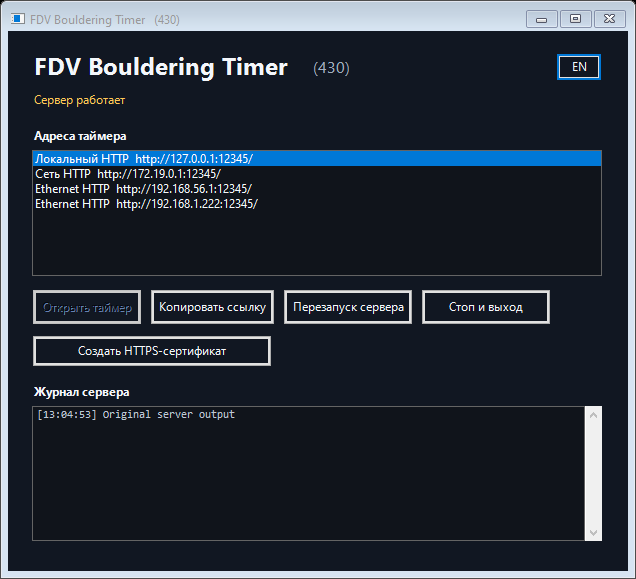

# Windows launcher build display — build430

The Windows header shows the product name followed by a smaller muted `(430)` with a14px gap. The window title also includes the build. The value comes from config.buildNumber in the existing startup readiness response; the EXE does not embed a build constant. Restart clears the previous value. Periodic health probes remain headers-only, with no extra requests. Audio, clocks and Unix launchers are unchanged.

Validation: modern and CLR2 launchers compile. All four Windows launcher tests pass with native UI tests enabled and NET2 references supplied. Passive native forms check absent/malformed values, updated build, clearing, RU/EN switching and minimum-width fit; both harnesses also read the build from a real isolated server. No live server was restarted. These are Win10 off-screen renders, not physical Win7/8 evidence.

Preview packages include newly compiled launcher binaries, verified by SHA256 against compiler outputs; runtime binaries retain the previous verified versions. Release-input verification passes for430. Standalone HTML is regenerated by the standard builder.
