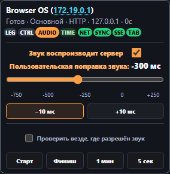
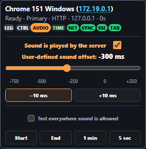

# Per-browser server sound switch — build431

The AUDIO editor has a checkbox to the right of the playback status. Checked (default) permits the automatic local Windows server route. Unchecked returns that browser to its own audio. RU/EN tooltips explain hidden/sleeping-tab signal loss, retained correction and saved preference. The switch remains reachable while server playback is off.

The preference uses the existing tab ID, independently of sound permission and the audio offset. A transient disconnect or expired diagnostic entry does not remove it. It survives reload and valid server snapshot restoration and is replicated to SEC. A newly created tab has its own ID and default setting, consistent with the existing browser correction identity.

The server rechecks the preference throughout prepare, activation, reconciliation and owner election. Opt-out revokes the native claim and queued output. Browser fallback waits for native cancellation acknowledgement (or the existing fenced watchdog fallback), with browser sound permission still intact. Opt-in mutes browser nodes before stream activation. Forced tests cannot override the opt-out. Cue targets, clock mathematics and correction values are unchanged. The editor refreshes status in place without replacing the slider or unsaved correction.

Validation includes coordinator cancellation and preparation races, deferred cancellation acknowledgement, per-client independence, expiry/reconnection and server restoration, SEC baseline/forwarded updates, real browser checkbox/reload/translation and corrected cue targets. Node12 x64/x86 preference restoration passes using bundled disposable servers. Native browser tests use a silent stub device; they do not establish physical acoustic timing on user hardware.

Windows preview packages use the unchanged build430 launcher, which reads build431 dynamically from the server. Standalone is regenerated through the normal builder; the server-only checkbox is absent there. No live server restart, publication or commit.

Final validation: Windows-compatible Node suite473 cases /468 passed /5 expected opt-in skips, with concurrency2. All33 distinct Chromium clock/CTRL/native/SEC scenarios passed across the main run and one isolated retry. An initial concurrent Node/browser run hit1s fixture HTTP timeouts (one Node SEC test and one Chromium hidden-desktop test); the bounded Node rerun and isolated Chromium retry passed without product changes. The focused coordinator/preference set passes29/29. Unrelated guide captures generated by regression tests were restored from430; only AUDIO RU/EN captures are updated for this feature.
