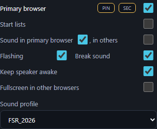

# Reachable full sound caption — build435

Build434 required321px of option-row width for the full caption, but the ordinary wide control column is capped at360px including40px padding and a border. Thus even without a scrollbar its row can reach only319px. The artificial-width test passed while missing the normal desktop layout.

The threshold is now300px, retaining10px spacing and the short caption/tooltip for medium and narrow layouts. The product change is one CSS threshold; audio/clock JavaScript is unchanged apart from build metadata.

Validation:3 Chromium cases passed. The new regression test uses normal layout without inline width overrides at1920x1080 and1600x900 (full),1280x900 and1024x900 (short), and1920x800/1920x680 (height-constrained compact controls). RU/EN are tested, as are caption height, spacing and checkbox containment. Explicit-width coverage now includes300px along with240/280/340/400; the existing standard-column tests also pass. The normal wide capture was visually inspected. Guide captures and architecture reference are updated.

Offline/standalone assets are regenerated. No live restart, publication or commit.
