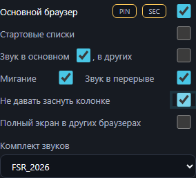
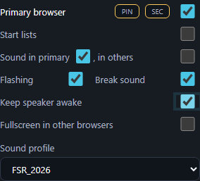

# Speaker keep-awake and compact sound controls — build432

The main sound checkbox now sits beside its text. The same row continues with “, в других” and the other-browser checkbox in the common right column. Its text tooltip is “Звук в других браузерах”. Flashing and break sound follow; the new default-on speaker switch follows them; fullscreen in other browsers is the last checkbox. Festival announcements remain available above the sound row when applicable. Narrow columns may wrap the long main sound caption while keeping the other-browser caption and right checkbox aligned.

The whole new row explains BT speaker sleep and params.txt configuration, in RU/EN. Parameters: speaker_keep_awake=true; speaker_keep_awake_interval_seconds=60, bounded10–600; speaker_keep_awake_gain=0.006, bounded0.0001–0.1 linear amplitude; speaker_keep_awake_frequency_hz=440, bounded100–2000Hz. Tones last150ms with fades. Restart after editing params. Existing snapshots without the switch use the default enabled setting; the current switch is shared, saved, restored and replicated to SEC. Standalone embeds parameters and retains the checkbox locally.

Quiet playback uses the existing sound permission and selected server/browser route. It operates during long sets, waiting and pauses. Late callbacks emit at most one pulse. Known real/diagnostic playback postpones pulses. The browser uses a separate oscillator which work/diagnostic buffer, synthetic, HTML, speech and gesture paths cancel. Native PCM removes quiet voices/cues in the presence of priority audio. Quiet cancellation does not stop, regenerate or shift the work schedule. Existing user correction and native anchor tolerance remain unchanged. This does not address the separately audited diagnostic-vs-work overlap; both have priority over the new quiet tone.

Evidence: full Windows-compatible Node478 cases /473 pass /5 expected opt-in skips; final focused suite35 cases /34 pass /1 device opt-in skip. Pure planner tests cover idle intervals, busy spans, delayed callbacks, backward clock changes and disabled/re-enabled state. Generated PCM amplitude/fade is checked. The device-free native renderer injects competing quiet cues and verifies sample-exact START/WARN output across refills, with no extra voices. Native coordinator verifies stopped-period pulses and quiet-only cancellation without Stop or generation change. Server tests verify snapshot restoration and SEC sharing. The same preference tests pass against actual bundled Node12 x64 and x86 servers.

Chromium tests cover separate browser quiet nodes, priority cancellation with unchanged work generation/anchor, default-on, reload, RU/EN tooltips, checkbox alignment at320/393/1024/1280, and offline standalone/Android HTML persistence. Broader clock/native/CTRL/SEC scenarios are run as regression checks. Native browser integration uses a silent stub; no physical BT speaker was tested. Actual effectiveness and audible level depend on the speaker; browser JS freezing/throttling can delay periodic tones. Native mode remains independent of tab activity.

Windows packages reuse the unchanged430 launcher, which displays server432 dynamically. No live server restart, APK rebuild, commit or publication.

Final browser regression run:34/34 passed (clock, CTRL, native route and SEC). Both standalone browser smoke checks and release-input/packaged-source/runtime/binary/private-entry checks pass. The three Windows preview ZIPs and standalone432 are recorded in dist/SHA256SUMS-build432-preview.txt. Standalone numeric settings are embedded when its HTML is generated, rather than read from a neighbouring params.txt at runtime.
